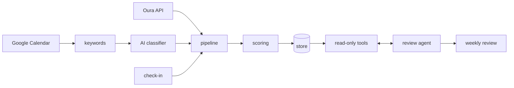
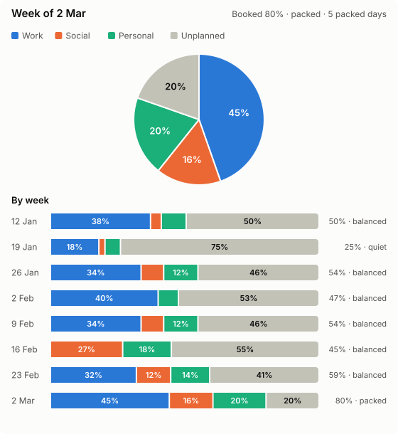

# Personal Metrics Tracker

A weekly scorecard for my personal metrics: sleep, activity, recovery, social plans, messages and variety. It replaces a hand-filled spreadsheet with one score out of 100 and a breakdown by segment.

It pulls data from my Oura ring and Google Calendar, adds a one-minute check-in, and scores the week. An AI agent (Claude) then writes a short weekly review from the scores.

Status: working prototype, tested on synthetic data. Not yet run against my live Oura and Calendar accounts.

More detail on requirements and the decisions behind them: [docs/PRD.md](docs/PRD.md).

## How it works



1. Pull the week from Oura (sleep, readiness, activity, stress, workouts) and Google Calendar.
2. Sort calendar events into categories with a keyword list. Anything it can't match goes to Claude Haiku in one batch.
3. Score the week in Python.
4. The review agent reads the scores through three read-only tools and writes a short summary with 1-3 suggestions.

## Scoring

Each segment is scored 0-100 against a modest target, so a normal busy week can still reach 100.

| Segment | Weight | Rule |
|---|---|---|
| Sleep | 15 | Oura sleep + readiness average ÷ 70 |
| Exercise | 20 | Oura activity score ÷ 70 |
| Stress | 15 | Share of days Oura didn't flag as stressful ÷ 70% |
| Social | 25 | Any social plan this week |
| Messages | 10 | No important message left unanswered |
| Variety | 15 | Different kinds of activity in the calendar ÷ 4 |

- Status: green is 90+, amber 60-89, red below 60. A segment at 0 two weeks running sets the week to red.
- Missing data isn't scored as 0. If the ring wasn't worn or the check-in was skipped, that segment is left out, the week is flagged as incomplete, and it can't be green.

## Tracked but not scored

Metrics that are recorded and shown, but don't affect the score:

- **Gym days**: from Oura workouts
- **Screen time**: entered at check-in (phones don't expose it to other apps)
- **Time split**: hours of work, social, personal and unplanned time, from the calendar
- **Busyness**: share of waking hours booked. Under 45% is quiet, over 75% is packed. A packed day has less than 2 hours free.

`python -m tracker.cli chart` draws the time split:



## Running it

```bash
python -m venv .venv && source .venv/bin/activate
make install
cp .env.example .env
```

Try it without any accounts:

```bash
python -m demo.run_demo
```

With real data, after creating an Oura OAuth app and a Google OAuth client (Desktop app) and filling in `.env`:

```bash
python -m tracker.cli auth oura
python -m tracker.cli auth gcal
python -m tracker.cli checkin
python -m tracker.cli pull
python -m tracker.cli summary
python -m tracker.cli chart
python -m tracker.cli review     # needs ANTHROPIC_API_KEY
```

Google tip: set the OAuth consent screen to "In production", otherwise the refresh token expires after 7 days.

Personal keywords (for example, to make a recurring appointment count as "ignore") go in `private_config.py`, which is gitignored. See `private_config.example.py`.

## The AI parts

**Calendar classifier.** Haiku only sees events the keyword list couldn't match, and it can only answer with one of a fixed set of categories. Answers are cached, so each event is only classified once. Without an API key it falls back to keywords.

**Weekly review.** Sonnet writes it, but every number comes from Python. The model gets read-only tools and is limited to 8 tool calls and 10 turns. If the API call fails, the weekly run still finishes.

**Evals.** `make evals` runs both against synthetic data:

- the classifier on 12 labelled event titles;
- the review on 5 example weeks. Each review is checked by code, not by another model: every number must come from the data, the status must be right, at most 3 suggestions, and no judgemental wording.

## Development

```bash
make check    # lint + tests, same as CI
make evals    # live model calls, costs a few pence
```

```
tracker/      scoring, storage, calendar time split, charts, CLI
  sources/    Oura, Google Calendar, AI classifier
agent/        review agent, tools, prompt
tests/        unit tests and agent evals
docs/         PRD
```

## Design decisions

- **Python does the maths, the model writes the words.** That's what makes the review testable.
- **Missing data isn't zero.** An unrecorded week shouldn't score as a low week, or as a complete one.
- **Gym isn't scored.** Exercise already covers general activity; gym count is shown for reference.
- **Variety only counts activities I chose.** Work, classes and fixed appointments are left out.
- **Storage sits behind a small interface.** It's JSON files for now; Azure Table Storage is next.

## Limitations

- Calendar events are taken as what happened. A cancelled plan counts unless it's deleted.
- The time split and busyness are only as accurate as the calendar.
- Oura field names haven't been checked against my real account yet.
- The evals are small: 5 scenarios and 12 classifier cases.
- It runs locally from the command line. Nothing runs on a schedule yet.
- What gets sent to Anthropic: unmatched event titles (for the classifier) and the weekly scores (for the review). Check-in notes and work calendar titles are never sent.

## Next

- Azure Table Storage, and a weekly timer on Azure Functions
- Weekly email with the review and an Excel report
- Phone check-in via Microsoft Forms and Power Automate
